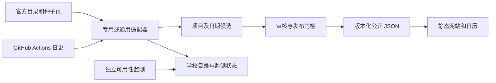
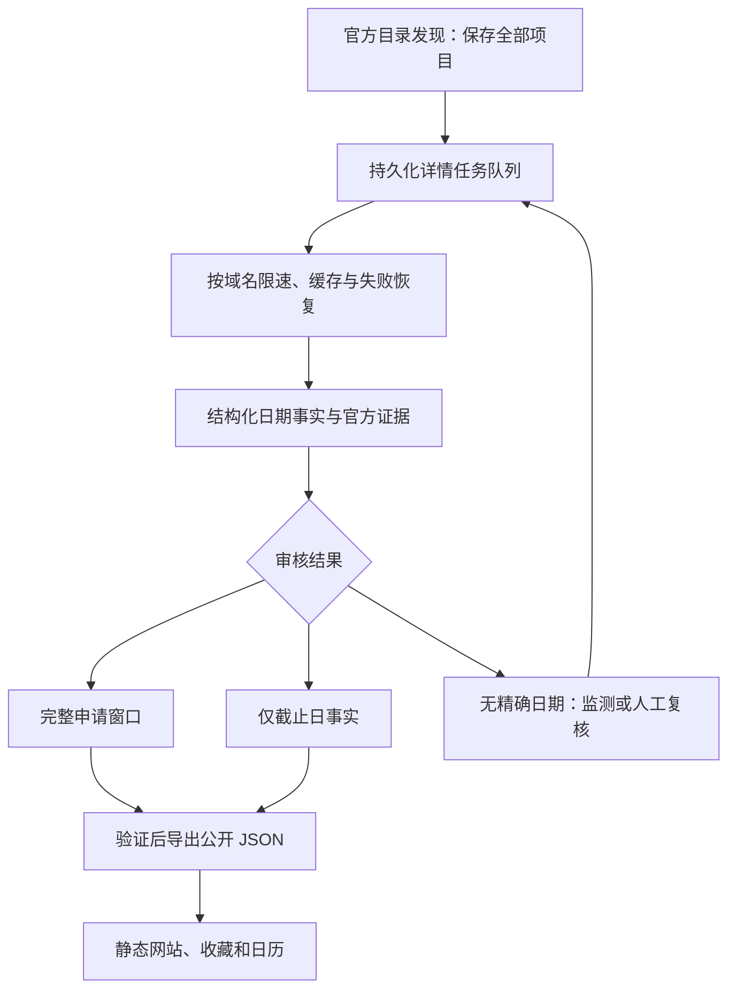

# GradWindow 架构与新项目信息获取审查

审查日期：2026-10-24。结论：优先补齐抓取进度持久化、详情轮转和日期复核流程。当前最需要解决的是已有抓取结果能否持续积累并完成审核；扩大抓取量或增加浏览器额度不能单独解决这些问题。

本次是架构审查，包含代码阅读、数据统计、GitHub Actions 状态检查和离线故障复现；未修改生产代码、公开数据或部署配置。

## 范围与证据边界

- 检查 Python 发现/审核/发布管道、适配器、HTTP 与浏览器获取、分片存储、前端构建及自动工作流。
- 远端 `main` 检查到 `b8525d4f8eecbdd86bf18ef4399532c8a0b30a6d`（2026-10-23）。与本地审查基线 `9528bad15d10aca61a728418ec809f17d662e88a` 比较，仅两个监测状态文件发生变化；本报告涉及的程序代码和其他数据一致。
- 大型候选集合与目录状态通过 `gradwindow.io.read_json` 读取，未直接解析分片 manifest 充当完整数据。
- 没有重新批量访问大学官网。本报告不能据此断言某所大学今天已经公布或尚未公布某个日期。
- 最新日更的失败步骤已确认，但日志接口返回 HTTP 403，未取得异常堆栈；因此不能把它的具体失败原因归结为 429、某所学校或某条数据。

## 当前架构中应保留的部分

公开页面由版本化数据构建为静态站点；账号、收藏等功能有独立 Worker 后端和 D1 表结构（见 [schema.sql](../subscriptions/schema.sql)）。公开招生数据和用户私有数据不需要放进同一套读写流程。

已有能力包括：302 所规范化大学共享排名视图、适配器注册表、候选与正式数据分离、官方证据校验、日期变更复核、按学校分片、单文件原子写入、HTTP 优先与受限浏览器回退、浏览器缓存及冷却机制。应在这些基础上改进，避免另建一条不受审核约束的数据发布路径。

当前获取链路大致如下：

## 数据现状

以下是仓库快照的记录数，不能解释为当前开放数量或完整覆盖率。

| 项目 | 数量 / 日期 | 含义 |
| --- | --- | --- |
| 规范化大学 | 302 | 多个排名视图共享，不是只维护 QS 200 所 |
| 正式项目元数据 | 29,809 | `programs.json` 元数据更新日为 2026-10-05 |
| 完整申请窗口 | 6,024 | 含不同周期及历史记录；更新于 2026-10-17 |
| 已复核的仅截止日事实 | 8 | 独立于完整起止日期窗口 |
| 待处理项目/日期指导候选 | 6,106 | 新项目 3,495；已知项目日期指导 2,611 |
| 上述候选解析状态 | 无日期 3,598；不完整 2,238；parsed 270 | parsed 不等于满足官方开学周期、开放日期及审核门槛 |
| 待处理完整窗口候选 | 1 | 与项目候选队列是不同集合 |
| 已登记适配器入口 | 302 | 登记数量不等于完成了每所学校的日期获取 |

## 按优先级排列的问题

### 1. 日更失败后，学校级进度和诊断未可靠保留（P1）

2026-10-18 至 2026-10-23 连续六次 `Update application windows` 失败，同期独立监测发布成功。最新一次 [2026-10-23 日更运行](https://github.com/lione12138/gradwindow/actions/runs/39931324464) 约运行 105 分钟，在 `Run daily pipeline` 步骤失败。

[update-data.yml](../.github/workflows/update-data.yml) 把整条日更放在一个 `gradwindow pipeline --skip-build` 步骤内。之后的学校健康汇总、翻译、测试和数据 PR 在失败时跳过。浏览器缓存有 `always()` 保存，工作流也有失败 issue 通知，但候选、学校进度和诊断没有同等级的失败保存机制。

这意味着前面学校产生的候选或状态修改可能只留在临时 runner 中；下一次运行不能可靠地从已完成学校继续。监测成功只说明相应页面检查完成，不能证明新项目发现或日期更新正常。

**建议：** 先取得失败堆栈；同时让每个学校任务保存独立运行记录、完整性标记和检查点。失败时也上传经过筛选的诊断与候选快照。恢复任务从失败或未完成阶段继续，公开发布仍须经过统一验证，不能直接发布未经审核的部分结果。

### 2. 替换候选先删旧数据，失败后无法保留（P1，已复现）

[generic_discovery_batch.py](../src/gradwindow/generic_discovery_batch.py) 第 64–65 行在访问各学校之前调用 `_remove_pending_batch_candidates`。因此显式使用 `--replace-existing` 时，即使学校随后被跳过或抓取失败，旧的匹配待审核项目也已经删除。该选项默认关闭，不能据此推断它导致了上述日更失败。

离线复现：起始有 1 条匹配的待审核项目；学校为 blocked 时结果为 skipped，剩余 0 条；模拟网络异常时结果为 error，仍剩余 0 条。没有访问外网或修改真实候选库。

**建议：** 每所学校先在临时区域生成并验证结果，只有成功且达到完整性要求后才替换对应候选。跳过、超时、受限或不完整结果应保留旧记录，并单独更新失败原因。已审核状态也必须保留。

### 3. 通用适配器反复检查同一批项目，预算以外的项目可能一直遗漏（P1，已复现）

[generic.py](../src/gradwindow/programme_adapters/generic.py) 第 114 行按项目 ID 排序后固定截取 `max_detail_pages`，没有跨运行的轮转记录。详情异常被转成 `None`，返回目录只包括成功解析的详情。

离线复现：目录包含 a、b、c 三个项目，详情预算为 2；连续运行两次，均访问 a、b，c 从未访问。增大预算只是延迟出现问题，不能保证覆盖。

**建议：** 保存完整目录，将“已发现项目”和“已检查详情”分开计数。详情任务按未访问、页面变化、近期申请周期及上次检查时间安排；保存 `lastAttemptAt`、`lastSuccessAt`、`nextFetchAt`、失败原因和重试次数。详情失败不应让已经发现的项目从目录中消失。

这不是所有适配器的共同实现：UCL 已按 `attemptedAt` 轮转，来源监测也已有按时间分配预算的逻辑，应该复用这些经验。

### 4. 有目录但没有日期，部分原因是复核链路尚未闭合（P1）

[programme_discovery.py](../src/gradwindow/programme_discovery.py) 已把不完整日期保存为 `known-programme-window-guidance`，不是直接丢弃；完整窗口仍要求官方明确的开放日期，这是应保留的真实性门槛。

目前已知缺口是：不完整日期候选尚缺少统一、持续的复核任务和转化流程。仅截止日事实通过 [reviewed_deadlines.py](../src/gradwindow/reviewed_deadlines.py) 的 `approve_deadline_file` 手工草稿入口维护；[source_monitor.py](../src/gradwindow/source_monitor.py) 只读取完整申请窗口，没有覆盖该独立集合。

两个代表性情况：

- **UCL：** [ucl_detail.py](../src/gradwindow/programme_adapters/ucl_detail.py) 会轮转详情、记录内容指纹及 `needs-date-review`，但明确标记为 `bounded-monitor-only`。检测到待复核内容不会自行变成完整窗口。需要补日期解析、证据与复核入口，不能把“目录已显示”当成日期适配完成。
- **Stanford：** [stanford.py](../src/gradwindow/programme_adapters/stanford.py) 从中央目录读取项目及截止日文本；仅靠此目录不能系统补齐院系页面的开放日期。应按院系/域名组织二级日期来源，先实现共用规则，再处理个别项目例外。

**建议：** 增加统一的日期事实候选：分别记录开放日、截止日、精度、入学周期、申请人类别、轮次、官方来源、证据片段和内容指纹。审核后按事实完整程度进入完整窗口或仅截止日集合；未知字段保持未知。历史周期保留但不作为当前周期推广展示。

### 5. HTTP 层缺少条件请求和直连限流等待信息（P2）

[http_client.py](../src/gradwindow/http_client.py) 已有域名间隔、连接复用和指数退避。浏览器回退也已有独立的配额与冷却处理，因此无需重新做一套浏览器限流器。

直连 HTTP 仍缺少统一的 ETag / Last-Modified 持久缓存及 304 正文复用；收到 429 时没有保存 `Retry-After`，而是使用上限 8 秒的通用退避。

**建议：** 对支持条件请求的官方来源优先使用内容指纹和 304；直连 429 遵守服务器等待时间，并保存域名冷却状态。把“本次检查时间”和“证据实际获取/审核时间”分开，缓存命中不能伪造新核验。

### 6. 分片降低了 Git 改动量，但尚未提供事务与任务协调（P2）

[io.py](../src/gradwindow/io.py) 已有单文件原子替换，并只重写变化的分片。但读取 manifest 会加载所有分片；写入仍遍历完整集合；删除废弃分片发生在更新 manifest 之前。最后一点存在中途崩溃留下失效引用的风险，本次只做了代码确认，未执行破坏性崩溃实验。

另外，多文件审核写入不构成一个数据库事务。当前工作流串行约束缓解了并发风险，但未来增加多个抓取 worker 后，需要任务领取、去重和提交一致性。

**建议：** 近期增加按学校读取/写入接口与可恢复快照提交；采用新版本目录写完、切换 manifest、最后清理旧版本的顺序。需要并行抓取时，再引入独立运营库保存任务、来源状态、候选和审核历史，以事务和任务租约协调。用户账号已有数据库，不必为这次审查重新迁移账号系统；静态网站可继续消费审核后的 JSON 导出。

### 7. 更新状态应分别反映发现、复核、发布和可用性（P2）

[site.py](../src/gradwindow/site.py) 第 546–553 行优先使用 `refresh-status.json` 中的时间，只有缺值才回退到申请窗口或监测状态。当前该状态仍记载 2026-10-05 的完整运行信息，申请窗口元数据已到 2026-10-17。

[publish-monitor-status.yml](../.github/workflows/publish-monitor-status.yml) 更新两个监测状态文件并构建站点，不同步刷新上述汇总。因此页面可能沿用较旧汇总；独立监测成功也不能代表整条数据更新成功。

**建议：** 分别记录目录发现成功、详情检查成功、审核发布成功和页面可用性检查时间，并展示失败阶段。阶段的部分成功不能覆盖整条日更的失败状态。

## 建议的获取链路

新增内部记录应围绕 `source_pages`、`fetch_jobs`、`crawl_runs`、`date_observations`、`review_tasks` 设计，而不是为每所大学再建独立更新路径。项目 ID 与既有候选审核关系保持稳定。

## 实施顺序与验收

| 批次 | 工作 | 可观察的验收结果 |
| --- | --- | --- |
| 第一批：避免丢结果 | 修复先删除后抓取；失败也保存学校级结果和诊断；定位当前日更异常 | blocked/error 保留旧候选；学校 A 完成、B 失败后，重跑能恢复 A 的成果；失败日志可定位到阶段和学校 |
| 第二批：保证覆盖 | 全目录独立保存；通用详情轮转；明确失败和未访问数量 | 三项目/预算二的第二轮能够访问第三个；失败详情保留目录；单校统计能解释全部项目去向 |
| 第三批：补日期转化 | 统一日期事实与复核队列；优先 UCL、Stanford；仅截止日纳入重检 | 候选保留官方证据；未知开放日不被补猜；审核可以选择完整窗口或仅截止日；历史周期不会冒充新周期 |
| 第四批：降低重复成本 | 条件请求、直连 Retry-After、阶段新鲜度；按学校存取 | 304 可复用已知正文；429 冷却跨任务生效；页面正确区分检查、复核与发布 |
| 并行化前 | 运营库事务、任务租约、幂等提交和快照导出 | 两个 worker 不会重复领取或覆盖同一任务；中途崩溃可恢复；公开导出始终通过验证 |

第一批和第二批不依赖购买更多抓取额度。数据库迁移应服务于可恢复任务和并发一致性；它本身不会补出官网尚未公布的日期，也不会替代学校规则及人工复核。

## 本次验证记录

- 代码及工作流检查；远端 `main` 与本地基线差异核对。
- 通过分片读取 API 统计项目、候选、完整窗口及仅截止日记录。
- 两类离线复现：替换时 blocked/error 导致旧候选消失；有限详情预算重复访问同一批项目。
- GitHub Actions 最近六日日更和监测状态核对；最新失败步骤确认，详细日志因接口权限无法取得。
- 未运行全量测试或生产抓取：本次交付仅为审查报告，没有行为变更。
